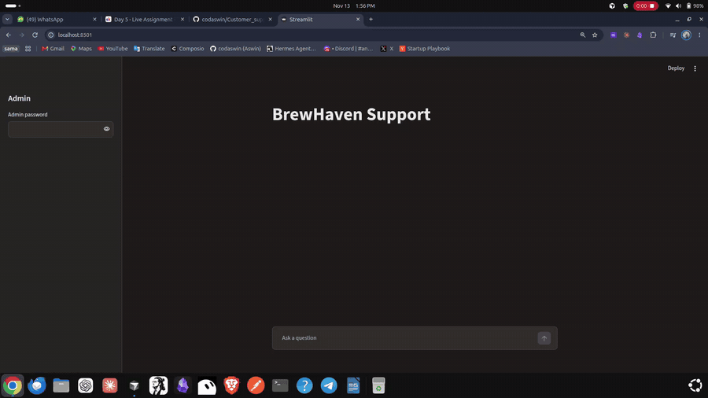

# BrewHaven Support: a 3-agent customer support system (CrewAI)

A customer support assistant for a fictional coffee shop, built with [CrewAI](https://www.crewai.com/). It answers questions from the company's own documents, falls back to a web search when the documents don't cover the question, and records every fallback so the business can see what its knowledge base is missing.

## Screenshot


The first question is answered from the company documents (badge: **Knowledge Base**). The second isn't covered by them, so it goes to web search (badge: **Fallback (web)**).

## Screencast



The app answering one question from the documents and one through web fallback. [Full-quality video (mp4)](assets/Screencast%20From%202026-11-13%2013-56-31.mp4).

## How it works

Three agents run one after another (CrewAI `Process.sequential`):

| # | Agent | Tool | What it does |
|---|-------|------|--------------|
| 1 | **Company Knowledge Base Agent** | `Knowledge Base Search` (RAG over ChromaDB) | Answers only from the documents in `data/`. If they don't cover the question, it outputs exactly `NOT_FOUND`. |
| 2 | **Web Search Fallback Agent** | `Web Search` (DuckDuckGo) | If Agent 1 said `NOT_FOUND`, searches the web and answers with a source URL. Otherwise it repeats Agent 1's answer unchanged. |
| 3 | **Query Logging Agent** | `Gap Log Writer` | If the web was used, appends the query and a timestamp to `logs/gap_log.txt`. Otherwise it logs nothing. |

**No hallucinated answers:** the Knowledge Base tool itself returns `NOT_FOUND` when the best-matching passage is too far from the question (cosine distance above `THRESHOLD` in `kb.py`). The agent can't answer from a weak match, so this doesn't rely on the prompt alone.

**Source badge:** each answer in the UI is labelled **Knowledge Base** or **Fallback (web)**. The label comes from whether Agent 1's raw output was `NOT_FOUND`, not from the wording of the final answer.

**Gap Log:** the timestamp is written by Python, not by the LLM. The sidebar shows the log only after entering `ADMIN_PASSWORD`, since it contains other customers' questions.

## Setup

Requires [uv](https://docs.astral.sh/uv/) (it installs Python 3.12 for you).

```bash
cp .env.example .env        # then edit: OPENAI_API_KEY, ADMIN_PASSWORD (MODEL is optional)
uv sync
uv run streamlit run app.py # opens http://localhost:8501
```

| Variable | Purpose |
|----------|---------|
| `OPENAI_API_KEY` | API key for the LLM |
| `MODEL` | OpenAI model name, default `gpt-4o-mini` |
| `ADMIN_PASSWORD` | Unlocks the Gap Log in the sidebar. If unset, the log stays hidden. |

## Try it

1. "How long do I have to return unopened coffee?" is answered from the documents.
2. "What are your opening hours on Saturday?" is also answered from the documents.
3. "Do you sell gift cards?" is not in the documents, so it falls back to the web and adds a line to the Gap Log.

## Project layout

```
app.py          Streamlit chat UI
crew.py         the 3 agents, their tasks and the sequential crew
tools.py        Knowledge Base Search, Web Search and Gap Log Writer tools
kb.py           indexes data/ into ChromaDB and searches it
ingest.py       rebuilds the index by hand
data/           the company documents (.txt or .pdf)
logs/           gap_log.txt (created on first fallback, gitignored)
tests/          pytest tests (no LLM or network calls)
```

## Using your own documents

Put `.txt` or `.pdf` files in `data/` and run `uv run python ingest.py`. The index also builds itself on first use if it doesn't exist.

The relevance cutoff `THRESHOLD` in `kb.py` was tuned by hand on the sample documents. Retune it if you change them: lower it to refuse more, raise it to answer more.

## Tests

```bash
uv run pytest
```

Checks that an in-document question finds its passage, that an off-topic one returns `NOT_FOUND`, and that the Gap Log tool writes a timestamped line.
